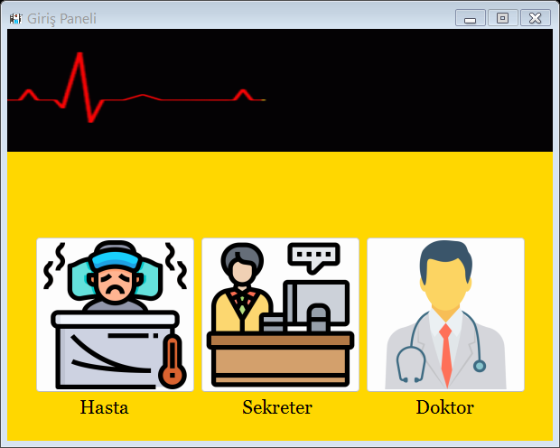

# HastaneProje 🏥

C# Windows Forms ile geliştirilen hastane randevu yönetim uygulaması. Hasta, doktor ve sekreter için ayrı giriş ve işlem ekranları içerir.

**Geliştirici:** Fatih Kılıç · **Tür:** Eğitim / portfolyo projesi.



## Özellikler

- Hasta kaydı, giriş, profil düzenleme, branş/doktor seçimi ve randevu alma.
- Doktor girişi, randevu/şikayet görüntüleme, profil düzenleme ve duyurular.
- Sekreter girişi, doktor/branş yönetimi, randevu oluşturma ve düzenleme.
- Duyuru oluşturma ve listeleme.
- Aynı randevu için ikinci rezervasyonu engelleyen koşullu SQL güncellemesi.
- Doktor/tarih/saat tekrarını ve ilişkili branşların silinmesini engelleyen veritabanı kısıtları.
- Parametreli SQL sorguları ve işlem sonunda kapatılan bağlantılar.
- PBKDF2-HMAC-SHA256 ile şifre hashleme; salt ve 600.000 iterasyon.
- Şifreler ekranlara veya doktor listesine yüklenmez. Düzenleme formunda boş şifre mevcut şifreyi korur.
- Kurulum SQL'i, yapay demo hesapları, otomatik kontroller ve GitHub Actions.

## Gerekenler

- Windows ve .NET Framework 4.7.2 (daha yeni uyumlu .NET Framework sürümü de çalışır).
- Visual Studio / Build Tools: **.NET desktop development**, .NET Framework 4.7.2 Developer Pack.
- SQL Server Express LocalDB veya SQL Server.
- PowerShell ve `sqlcmd` (SQL Server Command Line Utilities).

Bu proje ASP.NET sitesi değildir; Windows üzerinde masaüstü uygulaması olarak çalışır.

## Kurulum ve çalıştırma

```powershell
git clone https://github.com/fatihk123/HastaneProje.git
cd HastaneProje
.\scripts\Initialize-Database.ps1 -SeedDemo
```

Betik uygulamayı ve kontrol programını derler; LocalDB üzerinde **HastaneProjeDemo** veritabanını oluşturur ve `database/schema.sql` dosyasını uygular. `-SeedDemo`, tablolar boşsa yapay demo hesaplarını ekler. Var olan kayıtlar silinmez.

Visual Studio'da `Hastane_Proje.sln` dosyasını açıp **F5** ile çalıştırın. Alternatif olarak `Hastane_Proje/bin/Release/Hastane_Proje.exe` dosyasını açabilirsiniz.

### Demo hesapları

| Rol | Demo kimlik numarası | Şifre |
| --- | --- | --- |
| Hasta | `00000000001` | `Demo123!` |
| Doktor | `00000000002` | `Demo123!` |
| Sekreter | `00000000003` | `Demo123!` |

Kimlik numaraları, isimler, telefon ve randevular tamamen yapaydır. Demo kimlik numaraları gerçek T.C. kimlik doğrulaması amacıyla kullanılmaz. Uygulama giriş alanlarında yalnızca 11 rakam biçimini kontrol eder.

### Bağlantı ayarı

Varsayılan bağlantı `Hastane_Proje/App.config` dosyasındadır:

```text
Data Source=(localdb)\MSSQLLocalDB;Initial Catalog=HastaneProjeDemo;Integrated Security=True;TrustServerCertificate=True;
```

Başka bir SQL Server bağlantısını kaynak dosyalarına yazmadan ortam değişkeniyle kullanabilirsiniz:

```powershell
$env:HASTANE_CONNECTION_STRING = "Data Source=SUNUCU_ADI;Initial Catalog=HastaneProjeDemo;Integrated Security=True;TrustServerCertificate=True;"
```

Ortam değişkeni Visual Studio açılmadan önce ayarlanmalıdır; mevcut Visual Studio işlemi yeni terminalin ortamını otomatik olarak devralmaz.

`Initialize-Database.ps1 -Server SUNUCU_ADI -DatabaseName HastaneProjeDemo -SeedDemo` ile başka bir sunucuda kurulum yapılabilir. Betik Windows kimlik doğrulaması kullanır; parolaları GitHub'a göndermeyin.

## Kontroller

Yerel yardımcı kontroller:

```powershell
# Visual Studio Developer PowerShell içinde:
msbuild tests/HastaneChecks.csproj /p:Configuration=Release
.\tests\bin\Release\HastaneChecks.exe
```

SQL işlemleri ve form veri yüklemeleri için ayrı test veritabanı:

```powershell
.\scripts\Initialize-Database.ps1 -DatabaseName HastaneProjeVerification -SeedDemo
$env:HASTANE_CONNECTION_STRING = "Data Source=(localdb)\MSSQLLocalDB;Initial Catalog=HastaneProjeVerification;Integrated Security=True;TrustServerCertificate=True;"
.\tests\bin\Release\HastaneChecks.exe --database
```

Veritabanına yazan kontroller yalnızca **HastaneProjeVerification** adına izin verir. Test rezervasyonu temizlenir ve doktorun test değişikliği geri alınır. `--render` seçeneği formları masaüstünde açmadan PNG önizlemeleri üretir. GitHub Actions, Windows üzerinde derleme ve veritabanı gerektirmeyen kontrolleri çalıştırır.

## İncelemede giderilen sorunlar

- Yeni bir bağlantıyı açıp kapatarak asıl bağlantıyı açık bırakan kod kaldırıldı.
- Hasta/doktor/randevu filtreleri parametreli sorgulara dönüştürüldü.
- Yanlış indeks nedeniyle doktor şifresi yerine kimlik numarasının yüklenmesi düzeltildi; şifre artık hiç yüklenmiyor.
- Liste başlığına veya boş satıra tıklanınca oluşan hatalar engellendi.
- Randevu düzenleme verileri form açılmadan önce atanıyor; sekreter oturumu aktarılıyor.
- Değişikliklerden sonra listeler yenileniyor; branş seçenekleri yanlışlıkla silinmiyor.
- Gizli kalan giriş pencereleri nedeniyle uygulamanın kapanmaması giderildi.
- Eksik dış `.vdproj` kurulum projesi ve kullanılmayan `C:\Test.txt` bağımlılığı kaldırıldı.

## Veri ve kapsam

Depo yalnızca kaynak kodu, kurulum şeması ve yapay örnekler içerir; gerçek hasta verisi veya veritabanı yedeği içermez.

Önceki `HastaneProje` veritabanı otomatik olarak taşınmaz. Eski sürümün açık metin şifreleri yeni giriş sistemi tarafından kabul edilmez. Mevcut verileri taşımak için şema uyarlaması ve kontrollü şifre sıfırlama gerekir; kurulum betiği bu dönüşümü yapmaz. Başlangıç için ayrı demo veritabanını kullanın.

Bu bir eğitim/portfolyo uygulamasıdır. Gerçek hastane kullanımına uygun merkezi yetkilendirme, denetim kayıtları, kişisel veri yönetimi ve operasyonel süreçler bu sürümün kapsamı dışındadır.

Şifre saklama yaklaşımı için kaynak: [OWASP Password Storage Cheat Sheet](https://cheatsheetseries.owasp.org/cheatsheets/Password_Storage_Cheat_Sheet.html).
